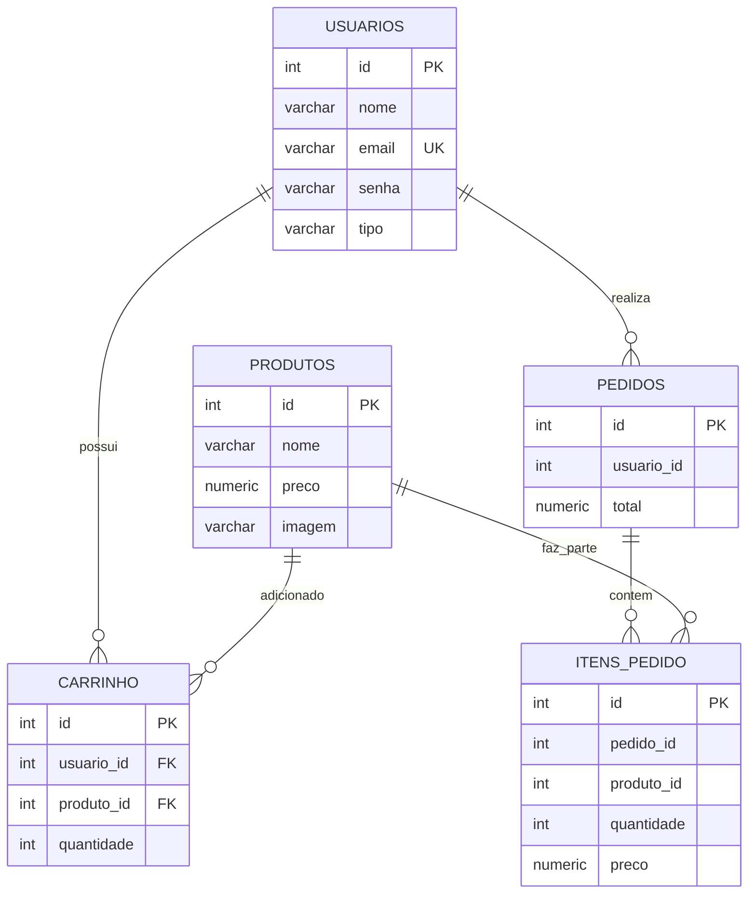

# PETITE PATISSERIE
### Sistema de Gestão e Vendas para uma Confeitaria

---

# 1. Apresentação do Projeto

A Petite Patisserie é uma aplicação web desenvolvida em PHP com foco na apresentação e no gerenciamento de produtos de uma confeitaria. O sistema foi criado para organizar os doces disponíveis, facilitar a consulta pelos clientes e permitir que a administração mantenha os produtos cadastrados e suas informações atualizadas.

A plataforma reúne páginas de apresentação da confeitaria, vitrine de produtos, pesquisa, carrinho de compras, autenticação de usuários e funcionalidades administrativas. O gerenciamento dos dados utiliza operações de cadastro, consulta, atualização e exclusão (CRUD), integradas a um banco de dados PostgreSQL.

O projeto também contempla o registro de pedidos e dos respectivos itens, relacionando os usuários aos produtos selecionados. A interface utiliza uma identidade visual em tons de rosa, adequada à proposta de uma confeitaria.

---

# 2. Como Executar o Projeto

Para rodar este projeto na sua máquina, será necessário ter instalado um ambiente de servidor local (**PHP**) e o banco de dados **PostgreSQL**.

## 2.1 Pré-Requisitos

- **PHP** (v7.4 ou superior) habilitado com a extensão `pdo_pgsql`.
- **PostgreSQL** instalado e em execução na porta padrão `5432`.
- **Git** instalado na máquina.
- Navegador web atualizado.

## 2.2 Passo 1: Clonar o Repositório

Abra o terminal e execute:

```bash
# Clone este repositório
git clone https://github.com/Livia-Simoes/petite_patisserie.git

# Acesse a pasta do projeto
cd petite_patisserie
```

## 2.3 Passo 2: Configurar o Banco de Dados (Restore do Dump)

O projeto conta com um arquivo de dump chamado `petite_patisserie.sql`, com a estrutura das tabelas e os dados armazenados no banco de dados. Siga os passos abaixo para restaurar o banco no PostgreSQL:

**1 -** Abra o terminal, Prompt de Comando ou PowerShell.

**2 -** Conecte-se ao PostgreSQL usando o usuário administrador `postgres`:

```bash
psql -U postgres
```

**3 -** Se o banco de dados já existir e for necessário recriá-lo, você pode apagá-lo e criar um novo para evitar conflitos. Dentro do terminal interativo do `psql`, digite:

```sql
DROP DATABASE IF EXISTS petite_patisserie;
CREATE DATABASE petite_patisserie;
\q
```

**Atenção:** a exclusão do banco apaga os dados existentes. Faça isso somente se não precisar preservá-los.

**4 - Restaurar o banco de dados**

Navegue para a pasta onde está localizado o arquivo `petite_patisserie.sql` do projeto clonado e restaure o banco de dados executando os seguintes comandos.

Se o arquivo estiver na raiz do projeto:

```bash
# Restaura o banco de dados
psql -U postgres -d petite_patisserie -f petite_patisserie.sql
```

Se o arquivo estiver dentro de uma pasta chamada `db`, utilize:

```bash
# Acesse a pasta db
cd db

# Restaura o banco de dados
psql -U postgres -d petite_patisserie -f petite_patisserie.sql

# Volte para a raiz do projeto
cd ..
```

**Atenção:** utilize a opção correspondente à localização real do arquivo `petite_patisserie.sql` no seu projeto.

## 2.4 Passo 3: Configurar a Conexão no PHP

**1 -** Na pasta `database`, abra o arquivo `connect.php`.

**2 -** Altere as credenciais para corresponderem às do seu ambiente local PostgreSQL:

```php
$host = 'localhost';
$port = '5432';
$dbname = 'petite_patisserie';
$user = 'petitepatisserie';
$password = '123456'; 
```

**Observação:** o usuário `petitepatisserie` deve existir no PostgreSQL e possuir as permissões necessárias para acessar o banco de dados. Não compartilhe sua senha pessoal no GitHub.

## 2.5 Passo 4: Acessar a Aplicação

Com o banco de dados configurado, inicie o servidor embutido do PHP. Certifique-se de que o terminal está na pasta correta e execute:

```bash
php -S localhost:8000
```

Se o terminal estiver na pasta principal do projeto, acesse:

```text
http://localhost:8000/
```

Caso o projeto esteja dentro de uma pasta chamada `petite_patisserie`, iniciando o servidor na pasta anterior a ela, o endereço será:

```text
http://localhost:8000/petite_patisserie/
```
---

## 2.6 Passo 5: Informações de Entrada

O sistema possui dois tipos de acesso: cliente e administrador.

Para entrar, utilize as contas cadastradas no banco de dados, respeitando o tipo de usuário correspondente.

As credenciais de acesso não são disponibilizadas nesta documentação.
# 3. Especificação de Requisitos de Software (SRS)

Documento organizado com referência à estrutura da ISO/IEC/IEEE 29148:2018. Os requisitos abaixo descrevem as funcionalidades identificadas no projeto Petite Patisserie.

## 3.1 Introdução

### 3.1.1 Escopo do Sistema

Este documento descreve os requisitos da aplicação Petite Patisserie, cujo escopo é oferecer uma plataforma web para apresentação de uma confeitaria e gerenciamento de seus produtos, usuários, carrinho e pedidos. O sistema permite que os clientes visualizem e pesquisem produtos, adicionem itens ao carrinho e realizem o fluxo de finalização de pedido. Também disponibiliza funcionalidades administrativas para manter os cadastros.

A aplicação utiliza PHP no desenvolvimento do back-end e PostgreSQL para armazenamento das informações.

### 3.1.2 Propósito

O propósito do projeto é desenvolver um sistema web que facilite a organização dos produtos de uma confeitaria e a interação dos clientes com a loja. O projeto também aplica conhecimentos de programação PHP, estruturação de páginas, operações CRUD, modelagem de dados e integração com banco de dados relacional.

## 3.2 Descrição Global

### 3.2.1 Interface e Identidade Visual

A interface da Petite Patisserie foi organizada para representar visualmente uma confeitaria, utilizando tons de rosa e elementos gráficos relacionados à marca. As páginas compartilham arquivos de estilo e componentes comuns, como o cabeçalho.

### 3.2.2 Funções do Sistema

- Apresentar a confeitaria e suas informações institucionais.
- Exibir os produtos cadastrados na vitrine.
- Pesquisar produtos disponíveis.
- Permitir o cadastro e a autenticação de usuários.
- Diferenciar o acesso de clientes e administradores.
- Cadastrar novos produtos, incluindo informações e imagem.
- Consultar, atualizar e excluir produtos por meio das funcionalidades administrativas.
- Adicionar produtos ao carrinho de compras.
- Consultar os itens adicionados e suas quantidades.
- Remover produtos do carrinho.
- Calcular o valor total dos itens selecionados.
- Registrar pedidos e seus respectivos itens durante a finalização.
- Armazenar os dados do sistema no PostgreSQL.

### 3.2.3 Características dos Usuários

| Usuário | Descrição |
|---|---|
| Cliente | Pessoa que acessa a loja para visualizar e pesquisar produtos, utilizar o carrinho e realizar o fluxo de finalização do pedido. |
| Administrador | Usuário responsável pelo gerenciamento dos produtos e pelo acesso às funcionalidades administrativas do sistema. |

## 3.3 Requisitos do Sistema

### 3.3.1 Requisitos Funcionais

#### Módulo de Acesso e Usuários

| ID | Título | Descrição | Prioridade |
|---|---|---|---|
| RF01 | Cadastro de usuários | O sistema deve permitir registrar usuários com seus dados de identificação e acesso. | Alta |
| RF02 | Login de cliente | O sistema deve permitir que o cliente informe suas credenciais para acessar as funcionalidades que exigem autenticação. | Alta |
| RF03 | Acesso administrativo | O sistema deve identificar o tipo de usuário e disponibilizar as funcionalidades administrativas somente ao administrador. | Alta |
| RF04 | Controle de sessão | O sistema deve utilizar sessões para manter o estado de autenticação durante a navegação. | Alta |

#### Módulo de Gestão de Produtos

| ID | Título | Descrição | Prioridade |
|---|---|---|---|
| RF05 | Cadastro de produtos | O sistema deve permitir cadastrar produtos com nome, preço e imagem. | Alta |
| RF06 | Consulta de produtos | O sistema deve apresentar os produtos cadastrados na vitrine, com suas informações. | Alta |
| RF07 | Pesquisa de produtos | O sistema deve permitir pesquisar produtos cadastrados. | Média |
| RF08 | Atualização de produtos | O sistema deve permitir alterar as informações de um produto cadastrado, preservando a imagem quando uma nova imagem não for enviada. | Alta |
| RF09 | Exclusão de produtos | O sistema deve permitir excluir produtos por meio da funcionalidade administrativa. | Alta |

#### Módulo de Carrinho e Pedidos

| ID | Título | Descrição | Prioridade |
|---|---|---|---|
| RF10 | Adicionar ao carrinho | O sistema deve permitir adicionar produtos selecionados ao carrinho do usuário. | Alta |
| RF11 | Consultar carrinho | O sistema deve exibir os produtos adicionados ao carrinho e suas quantidades. | Alta |
| RF12 | Remover do carrinho | O sistema deve permitir remover produtos do carrinho. | Alta |
| RF13 | Calcular total | O sistema deve calcular o valor total dos produtos presentes no carrinho. | Alta |
| RF14 | Finalizar pedido | O sistema deve permitir finalizar o pedido e registrar o pedido e seus itens no banco de dados. | Alta |

### 3.3.2 Requisitos Não Funcionais

| ID | Título | Descrição | Prioridade |
|---|---|---|---|
| RNF01 | Tecnologias | O sistema deve utilizar PHP no back-end e PostgreSQL como sistema gerenciador de banco de dados. | Alta |
| RNF02 | Acesso ao banco | A aplicação deve utilizar PDO para estabelecer a conexão e executar operações no banco de dados. | Alta |
| RNF03 | Organização do código | O projeto deve manter arquivos organizados, separando páginas, conexão, funções e estilos. | Média |
| RNF04 | Compatibilidade | O sistema deve poder ser acessado por meio de navegador web moderno. | Alta |
| RNF05 | Identidade visual | As páginas devem manter uma identidade visual consistente com a marca Petite Patisserie, utilizando tons de rosa. | Média |
| RNF06 | Usabilidade | A navegação deve apresentar links e ações compreensíveis para facilitar a utilização por clientes e administradores. | Média |
| RNF07 | Mensagens do sistema | O sistema deve apresentar mensagens que informem o usuário sobre erros, validações ou operações realizadas. | Média |

### 3.3.3 Regras de Negócio

| ID | Título | Regra / Condição |
|---|---|---|
| RN01 | Acesso administrativo | As páginas administrativas devem verificar se o usuário está autenticado e se sua sessão identifica o tipo administrador. |
| RN02 | Acesso do cliente | As funcionalidades destinadas ao cliente que exigem autenticação devem verificar a existência de uma sessão válida. |
| RN03 | Vínculo do carrinho | Os registros do carrinho devem estar associados ao usuário correspondente por meio de `usuario_id`. |
| RN04 | Vínculo dos produtos | Cada item do carrinho deve referenciar um produto cadastrado por meio de `produto_id`. |
| RN05 | Registro do pedido | Ao finalizar o fluxo de compra, o pedido deve ser registrado associado ao usuário, e seus produtos devem ser registrados em `itens_pedido`. |
| RN06 | Valores dos itens | O registro dos itens do pedido deve armazenar quantidade e preço do produto no contexto do pedido. |
| RN07 | Total do pedido | O total do pedido deve corresponder à soma dos valores dos itens considerados na finalização. |

---

# 4. Product Backlog

O Product Backlog reúne as funcionalidades e etapas desenvolvidas durante a criação da Petite Patisserie. Ele apresenta as atividades realizadas ao longo do projeto, suas prioridades e seus respectivos status. Todos os itens foram concluídos.

| ID | Item | Descrição | Prioridade | Status |
|---|---|---|---|---|
| PB01 | Identidade visual | Definir nome, logo e cores da confeitaria. | Alta | Concluído |
| PB02 | Página inicial | Criar a página principal e seus elementos visuais. | Alta | Concluído |
| PB03 | Página de produtos | Apresentar os doces disponíveis. | Alta | Concluído |
| PB04 | Página de serviços | Apresentar os serviços oferecidos. | Média | Concluído |
| PB05 | Página de contato | Apresentar as informações de contato. | Média | Concluído |
| PB06 | Cadastro de clientes | Permitir o cadastro de novos usuários. | Alta | Concluído |
| PB07 | Login de clientes | Autenticar clientes por e-mail e senha. | Alta | Concluído |
| PB08 | Login administrativo | Criar acesso separado para administradores. | Alta | Concluído |
| PB09 | Controle de sessões | Manter o usuário conectado e controlar acessos. | Alta | Concluído |
| PB10 | Cadastro de produtos | Cadastrar produtos com nome, preço e imagem. | Alta | Concluído |
| PB11 | Atualização de produtos | Editar produtos cadastrados. | Alta | Concluído |
| PB12 | Exclusão de produtos | Excluir produtos do banco de dados. | Alta | Concluído |
| PB13 | Listagem de produtos | Exibir os produtos na vitrine. | Alta | Concluído |
| PB14 | Pesquisa de produtos | Pesquisar produtos cadastrados. | Média | Concluído |
| PB15 | Gerenciamento de usuários | Atualizar e excluir usuários como administrador. | Média | Concluído |
| PB16 | Carrinho de compras | Adicionar produtos e visualizar itens selecionados. | Alta | Concluído |
| PB17 | Remoção do carrinho | Remover produtos do carrinho. | Alta | Concluído |
| PB18 | Cálculo do total | Calcular o valor total dos produtos no carrinho. | Alta | Concluído |
| PB19 | Finalização do pedido | Registrar pedidos e seus respectivos itens. | Alta | Concluído |
| PB20 | Conexão com o banco | Conectar o PHP ao PostgreSQL. | Alta | Concluído |
| PB21 | Elaboração do DER | Planejar entidades, atributos e relacionamentos. | Alta | Concluído |
| PB22 | Dicionário de dados | Documentar campos, tipos e descrições. | Alta | Concluído |
| PB23 | DER para SQL | Converter o modelo em comandos SQL. | Alta | Concluído |
| PB24 | Criação das tabelas | Criar as cinco tabelas no PostgreSQL. | Alta | Concluído |
| PB25 | Integração do banco | Armazenar e consultar informações pelo PHP. | Alta | Concluído |
| PB26 | Desenvolvimento do CSS | Estilizar as páginas conforme a identidade visual. | Média | Concluído |
| PB27 | Organização dos arquivos | Separar páginas, estilos, conexão e funções. | Média | Concluído |

---

# 5. Estruturação do Banco de Dados

O banco de dados da Petite Patisserie foi desenvolvido em PostgreSQL e é composto por cinco tabelas principais: `usuarios`, `produtos`, `carrinho`, `pedidos` e `itens_pedido`.

A modelagem foi realizada em etapas: primeiro foi elaborado o Diagrama Entidade-Relacionamento (DER); em seguida, foi produzido o dicionário de dados; depois, o modelo foi transformado em comandos SQL; por fim, as tabelas foram criadas no PostgreSQL e integradas ao sistema PHP.

## 5.1 Entidade: usuarios

Armazena os dados dos usuários e o tipo de acesso.

| Campo | Tipo | Restrições / relação | Descrição |
|---|---|---|---|
| id | INTEGER | Chave primária | Identificador único do usuário. |
| nome | VARCHAR(255) | NOT NULL | Nome do usuário. |
| email | VARCHAR(100) | UNIQUE, NOT NULL | E-mail utilizado para identificação e login. |
| senha | VARCHAR(255) | NOT NULL | Senha utilizada na autenticação. |
| tipo | VARCHAR(20) | Permite NULL | Tipo de acesso do usuário, como cliente ou administrador. |

## 5.2 Entidade: produtos

Armazena os produtos disponíveis na confeitaria.

| Campo | Tipo | Restrições / relação | Descrição |
|---|---|---|---|
| id | INTEGER | Chave primária | Identificador único do produto. |
| nome | VARCHAR(100) | NOT NULL | Nome do doce ou produto cadastrado. |
| preco | NUMERIC(10,2) | NOT NULL | Preço de venda do produto. |
| imagem | VARCHAR(255) | Permite NULL | Nome ou caminho do arquivo de imagem do produto. |

## 5.3 Entidade: carrinho

Registra os produtos adicionados ao carrinho dos usuários.

| Campo | Tipo | Restrições / relação | Descrição |
|---|---|---|---|
| id | INTEGER | Chave primária | Identificador do registro do carrinho. |
| usuario_id | INTEGER | Chave estrangeira, NOT NULL | Identifica o usuário relacionado ao registro. |
| produto_id | INTEGER | Chave estrangeira, NOT NULL | Identifica o produto adicionado ao carrinho. |
| quantidade | INTEGER | NOT NULL | Quantidade do produto no carrinho. |

## 5.4 Entidade: pedidos

Armazena os pedidos realizados pelos usuários.

| Campo | Tipo | Restrições / relação | Descrição |
|---|---|---|---|
| id | INTEGER | Chave primária | Identificador único do pedido. |
| usuario_id | INTEGER | NOT NULL | Identifica o usuário responsável pelo pedido. |
| total | NUMERIC(10,2) | NOT NULL | Valor total do pedido. |

## 5.5 Entidade: itens_pedido

Registra os produtos que fazem parte de cada pedido.

| Campo | Tipo | Restrições / relação | Descrição |
|---|---|---|---|
| id | INTEGER | Chave primária | Identificador único do item do pedido. |
| pedido_id | INTEGER | NOT NULL | Identifica o pedido ao qual o item pertence. |
| produto_id | INTEGER | NOT NULL | Identifica o produto registrado no item. |
| quantidade | INTEGER | NOT NULL | Quantidade do produto incluída no pedido. |
| preco | NUMERIC(10,2) | NOT NULL | Preço do produto registrado no item do pedido. |

---

# 6. Dicionário de Dados

O dicionário de dados foi elaborado para documentar os campos utilizados nas cinco tabelas do banco de dados da Petite Patisserie. Ele apresenta o nome de cada campo, sua descrição, o código utilizado no banco, o tipo da variável, o tamanho, a máscara e as opções de coluna.

## 6.1 Tabela: usuarios

| ID | Tabela | Nome do campo | Descrição do campo | Código do campo no banco de dados | Tipo da variável | Tipos de dados e tamanho da variável | Máscara campo | Opções de colunas |
|---:|---|---|---|---|---|---|---|---|
| 1 | usuarios | Código do usuário | Código de identificação do usuário no sistema. | id | Inteiro | INTEGER | 0–9 | Primary Key, Not Null, Auto Increment |
| 2 | usuarios | Nome do usuário | Nome completo do usuário cadastrado. | nome | Texto | VARCHAR(255) | A–Z | Not Null |
| 3 | usuarios | E-mail do usuário | E-mail utilizado para identificação e login. | email | Texto | VARCHAR(100) | E-mail | Not Null, Unique |
| 4 | usuarios | Senha do usuário | Senha armazenada em formato protegido (hash). | senha | Texto | VARCHAR(255) | Livre | Not Null |
| 5 | usuarios | Tipo de usuário | Identifica o tipo de acesso, como cliente ou administrador. | tipo | Texto | VARCHAR(20) | Livre | Null |

## 6.2 Tabela: produtos

| ID | Tabela | Nome do campo | Descrição do campo | Código do campo no banco de dados | Tipo da variável | Tipos de dados e tamanho da variável | Máscara campo | Opções de colunas |
|---:|---|---|---|---|---|---|---|---|
| 6 | produtos | Código do produto | Código de identificação do produto no sistema. | id | Inteiro | INTEGER | 0–9 | Primary Key, Not Null, Auto Increment |
| 7 | produtos | Nome do produto | Nome do doce ou produto cadastrado. | nome | Texto | VARCHAR(100) | A–Z | Not Null |
| 8 | produtos | Preço do produto | Valor de venda do produto. | preco | Numérico | NUMERIC(10,2) | 0,00 | Not Null |
| 9 | produtos | Imagem do produto | Nome ou caminho do arquivo de imagem do produto. | imagem | Texto | VARCHAR(255) | Livre | Null |

## 6.3 Tabela: carrinho

| ID | Tabela | Nome do campo | Descrição do campo | Código do campo no banco de dados | Tipo da variável | Tipos de dados e tamanho da variável | Máscara campo | Opções de colunas |
|---:|---|---|---|---|---|---|---|---|
| 10 | carrinho | Código do carrinho | Código de identificação do registro do carrinho. | id | Inteiro | INTEGER | 0–9 | Primary Key, Not Null, Auto Increment |
| 11 | carrinho | Código do usuário | Identifica o usuário associado ao registro do carrinho. | usuario_id | Inteiro | INTEGER | 0–9 | Foreign Key, Not Null |
| 12 | carrinho | Código do produto | Identifica o produto adicionado ao carrinho. | produto_id | Inteiro | INTEGER | 0–9 | Foreign Key, Not Null |
| 13 | carrinho | Quantidade do produto | Quantidade de unidades do produto no carrinho. | quantidade | Inteiro | INTEGER | 0–9 | Not Null |

## 6.4 Tabela: pedidos

| ID | Tabela | Nome do campo | Descrição do campo | Código do campo no banco de dados | Tipo da variável | Tipos de dados e tamanho da variável | Máscara campo | Opções de colunas |
|---:|---|---|---|---|---|---|---|---|
| 14 | pedidos | Código do pedido | Código de identificação do pedido no sistema. | id | Inteiro | INTEGER | 0–9 | Primary Key, Not Null, Auto Increment |
| 15 | pedidos | Código do usuário | Identifica o usuário associado ao pedido. | usuario_id | Inteiro | INTEGER | 0–9 | Not Null |
| 16 | pedidos | Total do pedido | Valor total dos produtos registrados no pedido. | total | Numérico | NUMERIC(10,2) | 0,00 | Not Null |

## 6.5 Tabela: itens_pedido

| ID | Tabela | Nome do campo | Descrição do campo | Código do campo no banco de dados | Tipo da variável | Tipos de dados e tamanho da variável | Máscara campo | Opções de colunas |
|---:|---|---|---|---|---|---|---|---|
| 17 | itens_pedido | Código do item | Código de identificação do item do pedido. | id | Inteiro | INTEGER | 0–9 | Primary Key, Not Null, Auto Increment |
| 18 | itens_pedido | Código do pedido | Identifica o pedido ao qual o item pertence. | pedido_id | Inteiro | INTEGER | 0–9 | Not Null |
| 19 | itens_pedido | Código do produto | Identifica o produto incluído no pedido. | produto_id | Inteiro | INTEGER | 0–9 | Not Null |
| 20 | itens_pedido | Quantidade do produto | Quantidade de unidades do produto no pedido. | quantidade | Inteiro | INTEGER | 0–9 | Not Null |
| 21 | itens_pedido | Preço do produto | Preço do produto registrado no item do pedido. | preco | Numérico | NUMERIC(10,2) | 0,00 | Not Null |

## 6.6 Observações sobre as opções de colunas

- **Primary Key (PK):** identifica exclusivamente cada registro da tabela.
- **Foreign Key (FK):** estabelece uma referência entre tabelas.
- **Not Null:** indica que o campo não pode ficar vazio.
- **Unique:** impede que o mesmo valor seja cadastrado mais de uma vez naquele campo.
- **Auto Increment:** indica que o identificador é gerado automaticamente pelo PostgreSQL.
- **Null:** indica que o campo permite não receber um valor.

Na estrutura exportada do banco, os campos `carrinho.usuario_id` e `carrinho.produto_id` possuem restrições de chave estrangeira. Os campos `pedidos.usuario_id`, `itens_pedido.pedido_id` e `itens_pedido.produto_id` são campos de referência, mas não possuem restrições `FOREIGN KEY` declaradas no dump.

---

# 7. Desenvolvimento do Banco de Dados

O desenvolvimento do banco de dados foi realizado em etapas, começando pelo planejamento da estrutura e seguindo até a integração com o sistema PHP.

## 7.1 Primeira etapa — Elaboração do DER

Inicialmente, foi elaborado o Diagrama Entidade-Relacionamento (DER), com o objetivo de planejar a estrutura do banco de dados antes da implementação. Nessa etapa foram definidas as cinco entidades principais — `usuarios`, `produtos`, `carrinho`, `pedidos` e `itens_pedido` —, seus atributos e os relacionamentos necessários ao funcionamento do sistema.

## 7.2 Segunda etapa — Elaboração do dicionário de dados

Após o DER, foi elaborado o dicionário de dados para documentar os campos de cada tabela, seus tipos e tamanhos, além da finalidade de cada atributo. Esse documento serviu como referência para a etapa de implementação.

## 7.3 Terceira etapa — Transformação do DER em código SQL

Com o modelo e os campos definidos, a estrutura foi convertida em comandos SQL. Essa etapa transformou o planejamento visual em instruções que poderiam ser executadas no PostgreSQL.

## 7.4 Quarta etapa — Criação das tabelas no PostgreSQL

Os comandos SQL foram executados no PostgreSQL para criar as cinco tabelas do banco de dados: `usuarios`, `produtos`, `carrinho`, `pedidos` e `itens_pedido`.

## 7.5 Quinta etapa — Integração com o sistema

Depois da criação das tabelas, o banco foi conectado ao sistema desenvolvido em PHP. A integração permite que as páginas consultem e manipulem os dados de usuários, produtos, carrinho e pedidos.

---

# 8. Diagramas

## 8.1 Diagrama Entidade-Relacionamento (DER)

O DER representa as entidades `usuarios`, `produtos`, `carrinho`, `pedidos` e `itens_pedido`, bem como os relacionamentos entre os registros. Ele foi utilizado como etapa inicial para planejar a estrutura do banco de dados.


---

# 9. Considerações Finais

O desenvolvimento da Petite Patisserie permitiu aplicar conceitos de desenvolvimento web com PHP, estilização com CSS, operações CRUD e integração com PostgreSQL. A construção do banco de dados foi realizada de forma organizada, começando pelo DER, passando pelo dicionário de dados e pela transformação do modelo em SQL, até a criação e integração das tabelas.

O projeto também envolveu a organização das funcionalidades por meio do Product Backlog, permitindo registrar as atividades realizadas e acompanhar sua conclusão.

Como resultado, foi construída uma aplicação voltada à apresentação e ao gerenciamento dos produtos da confeitaria, com recursos de pesquisa, carrinho e registro de pedidos, além de funcionalidades administrativas para manutenção dos cadastros.

---

# Prototipo
meu prototipo para acesso: https://drive.google.com/file/d/1fkHVtN0ODYquWZYwO86d6wlP1Pb6Mc9z/view?usp=sharing 
